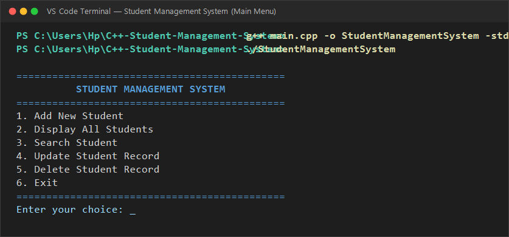
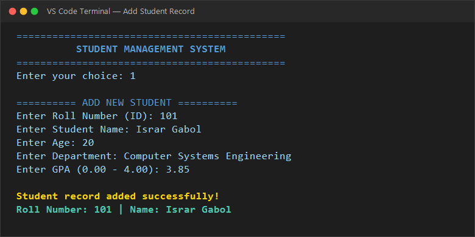
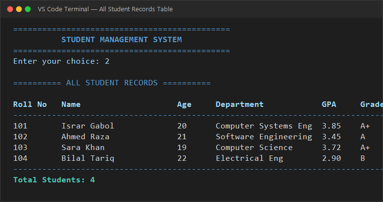
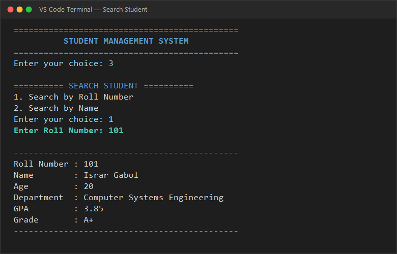
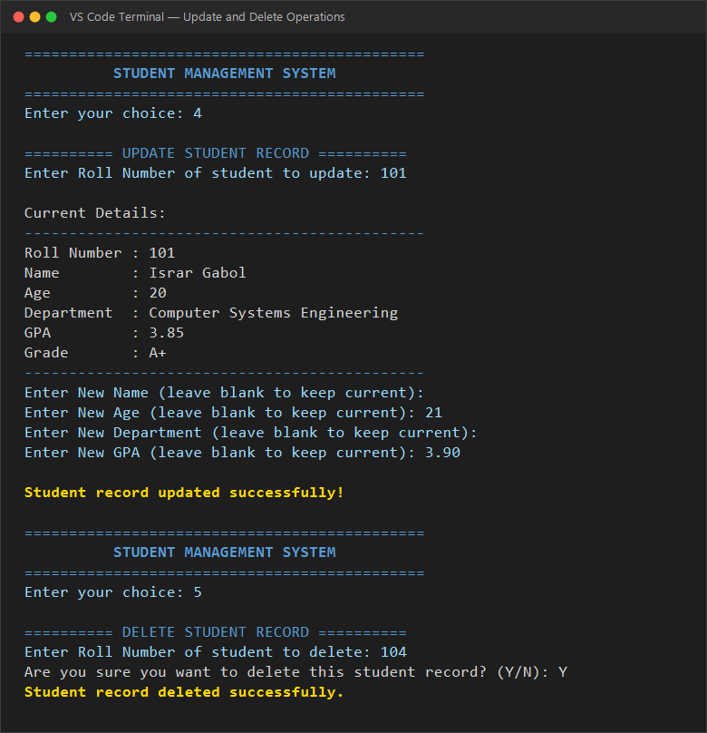

# C++ Student Management System

A modular, menu-driven **Student Management System** developed in **C++**. This project demonstrates essential Object-Oriented Programming (OOP) concepts, data structures, persistent file handling, defensive input validation, dynamic grade computation, and complete CRUD (Create, Read, Update, Delete) operations.

> **Note:** This is an **educational portfolio project** designed to illustrate software architecture and data management practices in modern C++. It is not intended as a production university management software.

---

## Table of Contents

- [Overview](#overview)
- [Features](#features)
- [Student Information Fields](#student-information-fields)
- [Concepts Used](#concepts-used)
- [Technologies Used](#technologies-used)
- [Project Structure](#project-structure)
- [Data Storage](#data-storage)
- [CRUD Operations](#crud-operations)
- [How to Run](#how-to-run)
- [Usage & Menu Options](#usage--menu-options)
- [Sample Output](#sample-output)
- [Screenshots](#screenshots)
- [Limitations](#limitations)
- [Future Improvements](#future-improvements)
- [Learning Outcomes](#learning-outcomes)
- [License](#license)

---

## Overview

The **C++ Student Management System** provides an interactive command-line interface for managing student academic records. Users can add new student profiles, view all enrolled records in an aligned tabular view, search for students by Roll Number or Name (with case-insensitive matching), update existing student information selectively, and delete student records with confirmation safeguards.

All student records are automatically saved to and loaded from a flat text file (`students.txt`), ensuring persistence across sessions without requiring external database dependencies.

---

## Features

- **Add New Student Record:** Captures Roll Number (ID), full Name, Age, Department, and GPA with duplicate prevention and range validation.
- **Display All Students:** Formats and prints all registered students in an organized tabular layout with aligned columns and total count.
- **Dual Search Capabilities:**
  - *Search by Roll Number:* Direct lookup returning detailed student record view.
  - *Search by Name:* Case-insensitive substring search matching partial or full names.
- **Update Student Information:** Selectively update Name, Age, Department, and/or GPA while keeping unmodified fields intact.
- **Delete Student Record:** Safely removes student records from memory and persistent storage after interactive confirmation (`Y/N`).
- **Dynamic Letter Grade Calculation:** Automatically evaluates and assigns academic letter grades (`A+` through `F`) based on GPA.
- **Flat-File Persistence:** Loads existing data upon startup and synchronizes changes immediately to `students.txt`.
- **Defensive Input Handling:** Protects against invalid numeric entries, stream failures, and string input buffer overflows.

---

## Student Information Fields

The application tracks and stores the following student data attributes:

| Field | Data Type | Validation / Constraints |
|---|---|---|
| **Roll Number** | `int` | Positive integer, unique identifier (no duplicates allowed) |
| **Student Name** | `string` | Full name, non-empty string |
| **Age** | `int` | Valid age range between `10` and `100` |
| **Department** | `string` | Academic department/major, non-empty string |
| **GPA** | `double` | Grade point average between `0.00` and `4.00` |
| **Letter Grade** | `string` | Evaluated dynamically: `A+` (>=3.7), `A` (>=3.3), `B+` (>=3.0), `B` (>=2.7), `C+` (>=2.3), `C` (>=2.0), `D` (>=1.0), `F` (<1.0) |

---

## Concepts Used

| Concept | Implementation in Code |
|---|---|
| **Classes & Objects** | Encapsulates student entities (`Student`) and administrative business logic (`StudentManagementSystem`) into structured classes. |
| **Encapsulation & Access Specifiers** | Data members are declared `private` and manipulated exclusively through `public` member functions, getters, and setters. |
| **Constructors** | Default and parameterized constructors initialize student objects cleanly with validated parameters. |
| **STL Vector (`std::vector`)** | Dynamically stores and manages in-memory collections of `Student` objects without fixed static array boundaries. |
| **File I/O (`std::ifstream` & `std::ofstream`)** | Implements persistent read and write routines using delimited (`\|`) flat-file serialization in `students.txt`. |
| **Input Validation & Stream Recovery** | Uses `cin.fail()`, `cin.clear()`, and `cin.ignore()` with `std::numeric_limits` to protect against stream corruption. |
| **String Manipulation & Algorithms** | Uses `std::getline()`, `std::string::find()`, `std::stoi()`, `std::stod()`, and `std::transform` with `::tolower` for case-insensitive searching. |
| **Formatted Console Reporting** | Employs `<iomanip>` manipulators (`std::setw`, `std::left`, `std::fixed`, `std::setprecision`) for clean, aligned tabular grids. |
| **Menu-Driven Programming** | Employs `do-while` control loops, `switch-case` branches, and modular helper routines for a structured console workflow. |

---

## Technologies Used

- **Language:** C++ (C++11 / C++17 / C++20 compatible)
- **Standard Library:** `<iostream>`, `<fstream>`, `<vector>`, `<string>`, `<iomanip>`, `<limits>`, `<algorithm>`
- **Compiler:** GCC / MinGW (`g++`) or MSVC / Clang
- **Development Environment:** Visual Studio Code / Terminal
- **Version Control:** Git & GitHub

---

## Project Structure

```text
C++-Student-Management-System/
│
├── main.cpp                 # Complete C++ source code (Student & StudentManagementSystem classes)
├── README.md                # Comprehensive project documentation
├── .gitignore               # Excludes build binaries, IDE configs, and local runtime data
├── LICENSE                  # MIT License file
│
└── screenshots/             # Application output previews
    ├── main-menu.png
    ├── add-student.png
    ├── student-records.png
    ├── search-student.png
    └── update-delete-student.png
```

### Runtime Generated Files
- `students.txt` — Stores student records formatted as `rollNumber|name|age|department|gpa`.

*(This file is excluded from git tracking via `.gitignore` to prevent local test data from polluting the repository.)*

---

## Data Storage

Data persistence is implemented using flat-file text storage:

1. **Format:** Each student record occupies a single line formatted as `rollNumber|name|age|department|gpa`.
   - *Example:* `101|Israr Gabol|20|Computer Systems Engineering|3.85`
2. **Lifecycle:**
   - **On Startup:** `loadFromFile()` reads `students.txt`, tokenizes each line, and populates the in-memory vector.
   - **On Modification:** `saveToFile()` rewrites the updated in-memory vector to `students.txt` after any add, update, or delete operation.

---

## CRUD Operations

| Operation | Application Method | Description |
|---|---|---|
| **Create** | `addStudent()` | Prompts for student details, verifies uniqueness of Roll Number, validates ranges, and adds record. |
| **Read** | `displayAllStudents()` & `searchStudent()` | Renders formatted table of all students or queries individual records by ID or Name. |
| **Update** | `updateStudent()` | Modifies existing student fields (Name, Age, Department, GPA) while retaining untouched values. |
| **Delete** | `deleteStudent()` | Displays target record and removes it from the vector and storage file upon user confirmation. |

---

## How to Run

### Prerequisites
- A standard C++ compiler supporting C++11 or higher (such as **MinGW / GCC `g++`**, **Clang**, or **MSVC**).
- **VS Code** or any standard terminal / command prompt.

---

### Step 1: Clone the Repository
```bash
git clone https://github.com/isrargabol/C--Student-Management-System.git
cd C--Student-Management-System
```

### Step 2: Compile the Source Code
Using the standard `g++` compiler:

```bash
g++ main.cpp -o StudentManagementSystem -std=c++17
```

### Step 3: Run the Application

**On Windows:**
```bash
StudentManagementSystem.exe
```

**On Linux / macOS:**
```bash
./StudentManagementSystem
```

---

## Usage & Menu Options

Upon running the application, the interactive main menu is presented:

```text
=============================================
          STUDENT MANAGEMENT SYSTEM
=============================================
1. Add New Student
2. Display All Students
3. Search Student
4. Update Student Record
5. Delete Student Record
6. Exit
=============================================
Enter your choice: 
```

| Option | Action |
|---|---|
| `1` | Adds a new student record with input validation. |
| `2` | Lists all registered students in a formatted tabular layout. |
| `3` | Searches for students by Roll Number or Name. |
| `4` | Updates existing student information selectively. |
| `5` | Deletes a student record with confirmation (`Y/N`). |
| `6` | Exits the application cleanly. |

---

## Sample Output

### 1. Adding a Student
```text
========== ADD NEW STUDENT ==========
Enter Roll Number (ID): 101
Enter Student Name: Israr Gabol
Enter Age: 20
Enter Department: Computer Systems Engineering
Enter GPA (0.00 - 4.00): 3.85

Student record added successfully!
Roll Number: 101 | Name: Israr Gabol
```

### 2. Displaying All Students
```text
========== ALL STUDENT RECORDS ==========

Roll No   Name                    Age     Department            GPA     Grade   
--------------------------------------------------------------------------------
101       Israr Gabol             20      Computer Systems Eng  3.85    A+      
102       Ahmed Raza              21      Software Engineering  3.45    A       
103       Sara Khan               19      Computer Science      3.72    A+      
104       Bilal Tariq             22      Electrical Eng        2.90    B       
--------------------------------------------------------------------------------
Total Students: 4
```

### 3. Searching for a Student
```text
========== SEARCH STUDENT ==========
1. Search by Roll Number
2. Search by Name
Enter your choice: 1
Enter Roll Number: 101

---------------------------------------------
Roll Number : 101
Name        : Israr Gabol
Age         : 20
Department  : Computer Systems Engineering
GPA         : 3.85
Grade       : A+
---------------------------------------------
```

### 4. Updating a Student Record
```text
========== UPDATE STUDENT RECORD ==========
Enter Roll Number of student to update: 101

Current Details:
---------------------------------------------
Roll Number : 101
Name        : Israr Gabol
Age         : 20
Department  : Computer Systems Engineering
GPA         : 3.85
Grade       : A+
---------------------------------------------
Enter New Name (leave blank to keep current): 
Enter New Age (leave blank to keep current): 21
Enter New Department (leave blank to keep current): 
Enter New GPA (leave blank to keep current): 3.90

Student record updated successfully!
```

---

## Screenshots

### 1. Main Menu
<p align="center">
  
</p>

### 2. Add Student
<p align="center">
  
</p>

### 3. Student Records Table
<p align="center">
  
</p>

### 4. Search Student
<p align="center">
  
</p>

### 5. Update & Delete Operations
<p align="center">
  
</p>

---

## Limitations

As a student-level educational console application, the system has several intentional design boundaries:
- **Console Interface (CLI):** Does not feature a graphical UI (GUI) or web portal.
- **Local Flat-File Storage:** Uses plain text files (`students.txt`) rather than a multi-user ACID relational database server.
- **Single-User Scope:** Designed for single-session desktop execution without multi-threaded concurrency locking.
- **Basic Security:** Student records are stored in clear text without encrypted fields or role-based login credentials.

---

## Future Improvements

Potential enhancements planned for future iterations:
- [ ] **Graphical User Interface (GUI):** Build a desktop frontend using **Qt** or **wxWidgets**.
- [ ] **Database Integration:** Migrate flat-file storage to **SQLite** or **MySQL** for robust relational querying.
- [ ] **Student & Admin Authentication:** Implement separate login dashboards for students and faculty.
- [ ] **Course & Semester Enrollment:** Add multi-course registration and credit-hour weighted CGPA calculations.
- [ ] **Attendance Tracking:** Record and report student class attendance percentages.
- [ ] **Export Reports:** Generate downloadable PDF / CSV student transcripts and grade cards.

---

## Learning Outcomes

Building this project reinforced core software engineering and C++ concepts:
- Designing clean, modular code using **Object-Oriented Programming (OOP)**.
- Managing collections of domain entities safely using **STL Vectors** (`std::vector`).
- Implementing resilient **file serialization and deserialization** algorithms.
- Handling defensive user input parsing to prevent crash loops and malformed states.
- Implementing complete **CRUD operations** in a console application.

---

## License

This project is licensed under the **MIT License** — feel free to use and adapt this code for educational and learning purposes.
